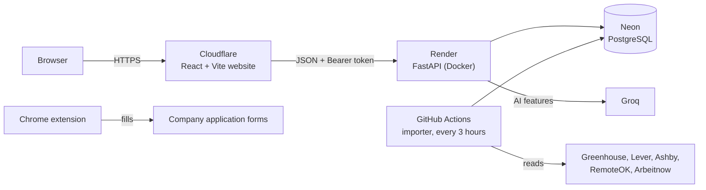

<h1 align="center">SwipeX</h1>

<p align="center">
  <b>Swipe-based job discovery with real company checks, resume matching and one-click autofill</b><br/>
  Live site: <a href="https://swipex.jobslist.workers.dev">swipex.jobslist.workers.dev</a>
</p>

<p align="center">
  </p>

<p align="center">
  
  
  
  
  
  
</p>

---

## Overview

Job hunting means scrolling long lists, guessing which companies are real, and typing the same details into every form. SwipeX tackles all three:

- **Job seekers** swipe through jobs, see how well their resume matches, check whether a company and posting look safe, and fill company application forms with a Chrome extension.
- **Recruiters** set up a company (with team invites), post jobs and review applicants.
- **Admins** run the platform while seeing only account basics and counts, never private profile content.

Jobs come from the official boards of real companies (Greenhouse, Lever, Ashby) plus clearly labelled third-party sources.

> SwipeX is a portfolio project. It runs on free hosting, so the server sleeps after 15 minutes without traffic and the first request can take about 30 seconds.

---

## Features

### Job seekers
- Swipe cards (right saves, left skips, undo, arrow keys), Liked and Skipped lists (skipped jobs clear after 15 days)
- Home page with search and "Jobs for you" ranked by profile skills, resume skills, location, experience level and past likes
- Jobs page with a split view on laptops, a country filter, saved searches and bell notifications for new matches
- Resume upload (PDF checks, up to 5), resume health score, skills match % on job cards, ATS-style match with TF-IDF, and AI tips that may only reword facts already in the resume
- Safety check on every job (fees, ID or OTP requests, WhatsApp-only contact, "guaranteed income" wording)
- Company Trust Card: official board, website over HTTPS, domain age, public records (Wikidata) and hiring response stats
- Company search for any company: jobs, news, photos, videos and an optional AI summary
- Applications tracking: Saved, Applied, Shortlisted, Interview, Rejected
- Autofill Chrome extension: fills Greenhouse, Lever and Ashby forms from saved details; never submits and never answers diversity questions; optional AI answers for extra questions
- Profile with photo, education, experience, portfolio and an optional public page
- Help chatbot, light and dark theme, feedback and problem reports

### Recruiters
- Company profile, verification request, job posting, editing, closing and reopening
- Company teams with an invite code
- Applicant review with filters, sorting, resume download and status changes (the applicant gets a notification)
- Postings that ask candidates for money are blocked

### Admins
- Users, company verification and feedback
- Monitor, System (health, errors, worker heartbeat) and Analytics (counts only)
- Privacy by design: no profile contents, resumes or application details, and every account view is written to an activity log

### Account and privacy
- Sign-in with no email service: recovery codes for forgotten passwords, plus change password
- Download all my data (ZIP) and delete my account
- Privacy Policy and Terms pages

---

## Architecture



| Part | Where it runs |
|---|---|
| Website | Cloudflare (free) |
| API | Render free plan (Docker, Singapore) |
| Database | Neon free plan (Singapore). Resumes and photos are stored here too |
| Job importer | GitHub Actions, every 3 hours |
| Uptime | Health check at `/health` |

Notes on the free stack: Render sleeps after 15 minutes, Neon sleeps after 5 and has a monthly compute limit, so the importer runs every 3 hours and keep-alive pings use `/health`, which does not wake the database.

---

## Tech stack

| Layer | Technology |
|---|---|
| Frontend | React (Vite), React Router, Axios, Framer Motion, plain CSS (soft capsule theme) |
| Backend | Python 3.12, FastAPI, SQLAlchemy 2, Alembic, Pydantic v2, APScheduler |
| Auth | JWT (PyJWT), argon2 hashing (pwdlib), recovery codes, rate limits |
| Data | PostgreSQL 16 locally, Neon in production |
| AI | Groq through one OpenAI-compatible helper (`app/ai.py`) |
| Resume and matching | pypdf, scikit-learn (TF-IDF), a shared skill finder (`app/skills.py`) |
| Extension | Chrome Manifest V3 |
| Quality | pytest (254 tests), ESLint, GitHub Actions CI |
| Delivery | Docker, Docker Compose, Cloudflare, Render, Neon, GitHub Actions |

---

## Build log

SwipeX was built one day at a time.

| Days | What was built |
|---|---|
| 1 to 3 | Repo, FastAPI, React, PostgreSQL in Docker, the first tables |
| 4 to 6 | Sign-up, login with JWT, roles, admin user management |
| 7 to 8 | Job seeker profile, experience and portfolio |
| 9 to 10 | Sample jobs, job list, search, filters, competition level |
| 11 | Swipe cards, save, skip and undo |
| 12 to 14 | Recruiter company and job posting, resumes and applying, applicant review |
| 15 | Alembic migrations, company verification, verified-only jobs |
| 16 | Live job import from official Greenhouse boards |
| 17 | Company Trust Card (Wikidata, HTTPS, domain age, hiring stats) |
| 18 | Full job page, light and dark theme |
| 19 | Application details and review-before-apply |
| 20 | Autofill Chrome extension |
| 21 | Lever, Ashby and Adzuna sources, internships, safety check, scam blocking |
| 22 to 23 | Company search with news and AI summary, help chatbot, AI autofill answers |
| 24 | Home page, split-view Jobs, worldwide jobs, third-party sources |
| 25 to 26 | Resume reading and health check, match %, ranked "Jobs for you", AI resume tips |
| 27 to 28 | Smarter recommendations, saved searches, bell notifications |
| 30 | Company teams, job editing, applicant filters |
| 31 | Photo, education, public profile, privacy-first admin view |
| 32 to 33 | Automated tests for every area |
| 34 | Rate limits, PDF checks, security headers, CORS |
| 35 to 36 | Download and delete my data, Privacy Policy and Terms, recovery codes, feedback |
| 37 | Error tracking, health checks, worker heartbeat, System page |
| 38 | Admin analytics (counts only) |
| 39 | Docker production setup |
| 40 | Free hosting chosen: Neon, Render, Cloudflare, GitHub Actions |
| 41 | Files stored in the database, old-job cleanup, migration 0013, 254 tests passing |
| 42 | Backend live on Render, real client IP for rate limits |
| 43 | Hourly-then-3-hourly job import on GitHub Actions, lock fix for Neon |
| 44 | Website live on Cloudflare, CORS, API address |
| 45 | Hosting and HTTPS added to the Privacy Policy |
| 46 | CI: backend tests, undefined-name check, lint and build on every push |

Email alerts (a planned Day 29) were dropped on purpose: notifications stay in the app, and no email service means less personal data.

---

## Roadmap

**Next**
- [ ] Day 47: package the autofill extension for the live site
- [ ] Day 48: backups, keep-alive and uptime alerts
- [ ] Days 49 to 50: beta with 10 to 20 users
- [ ] Day 51: legal check of job-source terms
- [ ] Days 52 to 53: landing page and demo
- [ ] Day 54: final review

**Later**
- [ ] LinkedIn-style features (feed, connections)
- [ ] Play Store app

---

## Security and privacy

- Passwords are stored only as argon2 hashes. Recovery codes are stored as keyed one-way hashes and each works once
- Login, sign-up, recovery and feedback have rate limits. The real client IP is read behind Render's proxy
- Role checks on every route, and users only reach their own data
- Uploaded PDFs are checked by content: no scripts, no password locks, at most 10 pages and 5 MB
- Security headers on the API and the website, strict CORS, API docs hidden in production
- Admins see only account basics and counts, and every account view is logged
- Error reports hide emails, tokens and long numbers
- `.env` files and uploads are ignored by Git

---

## Getting started (local)

**You need:** Git, Python 3.12 or newer, Node.js (LTS) and Docker Desktop. The commands are for Windows PowerShell.

```powershell
git clone https://github.com/narasimha4576/swipeX.git
cd swipeX
docker compose up -d

cd backend
python -m venv .venv
.venv\Scripts\Activate.ps1
pip install -r requirements.txt
Copy-Item .env.example .env
```

Open `backend/.env`, replace `SECRET_KEY` with a long random string (`python -c "import secrets; print(secrets.token_hex(32))"`), then:

```powershell
alembic upgrade head
python create_admin.py
uvicorn app.main:app --reload
```

In a second terminal:

```powershell
cd frontend
npm install
npm run dev
```

Open http://localhost:5173. Shortcuts once everything is installed: `.\start-backend.ps1` and `.\start-frontend.ps1`.

Run the tests from the `backend` folder:

```powershell
cd backend
pytest
```

### Configuration

| Variable | Meaning |
|---|---|
| `DATABASE_URL` | PostgreSQL connection string |
| `SECRET_KEY` | Secret for login tokens (32 characters or more) |
| `APP_ENV` | `production` hides API docs and enforces strict settings |
| `CORS_ORIGINS` | Website address allowed to call the API |
| `TRUST_PROXY` | `true` behind Render, so real client IPs are used |
| `IMPORT_ENABLED`, `RUN_SCHEDULER_IN_API` | Switch the importer on the API on or off |
| `AI_BASE_URL`, `AI_MODEL`, `AI_API_KEY` | Any OpenAI-compatible AI service (Groq by default) |
| `JOB_RETENTION_DAYS`, `SKIP_RETENTION_DAYS` | How long old jobs and skipped jobs are kept |
| `VITE_API_URL` | API address used by the website build |

---

## Project structure

```text
swipeX/
|-- backend/
|   |-- app/
|   |   |-- main.py, models.py, schemas.py, security.py, deps.py
|   |   |-- routers/        auth, jobs, swipes, applications, recruiter, team,
|   |   |                   profile, resumes, autofill, explore, admin_*, feedback ...
|   |   |-- importers/      greenhouse, lever, ashby, adzuna, third-party, scheduler
|   |   |-- trust/          Wikidata, domain and website checks, trust card
|   |   `-- safety.py, skills.py, resume_tools.py, ai.py, match_quick.py ...
|   |-- alembic/            database migrations (0001 to 0013)
|   |-- tests/              254 pytest tests
|   `-- run_scheduled.py    one importer run for GitHub Actions
|-- frontend/
|   |-- src/                React pages, styles, helpers
|   `-- wrangler.jsonc      Cloudflare deployment settings
|-- extension/              SwipeX Autofill (Chrome, Manifest V3)
|-- .github/workflows/      tests.yml (CI), import.yml (job importer)
|-- docker-compose.prod.yml, compose.yml, start-*.ps1, dc.ps1
`-- docs/schema.md          database diagram
```

---

## Author

Built by **Narasimha** (B.Tech AI/ML, Bengaluru) as a hands-on full-stack and AI project.
GitHub: [@narasimha4576](https://github.com/narasimha4576)